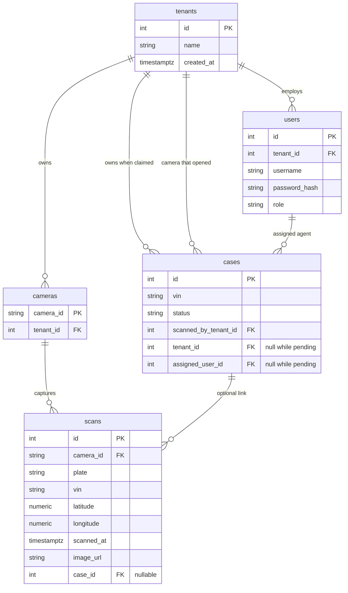

# Design note

## Schema

Five tables. Integer keys, except `cameras.camera_id`, which is the string the webhook sends (`cam_1001`).

Case status is `pending_claim`, `active`, or `closed`. A check constraint ties ownership to status: a pending case has no owner, an active case has both a tenant and an agent, and a closed case keeps its tenant.

A unique index allows only one non-closed case per VIN. Claim also locks the row with `SELECT … FOR UPDATE`, so two staff members cannot both become the owner.

Scans are indexed by `(vin, scanned_at)` because the location trail is that query. The trail does not depend on `scans.case_id`. That column is set when this agency's active case, or a newly opened pending case, is the one the sighting belongs to. The list itself is every scan stored for the VIN.

## Multi-tenancy

A user belongs to exactly one tenant. A camera belongs to exactly one tenant. The scan webhook has no login. The tenant for that request is `cameras.tenant_id` for the posted `camera_id`.

Dashboard routes read the user id from the JWT, load the user, and use that row's `tenant_id`. A tenant id in a request body is ignored because the body does not carry one.

What a signed-in user can see:

- Their tenant's cases at every status.
- Every `pending_claim` case, including one opened by another agency's camera.

What they cannot see:

- Another tenant's active or closed cases.
- The location trail of those cases. The API returns 403 if the case exists and 404 if it does not.

Claim is the deliberate exception. Any authenticated staff user may claim a `pending_claim` case. The case then becomes `active`, `tenant_id` becomes the claimer's tenant, and `assigned_user_id` becomes that user. Other agencies lose it from the claimable list and cannot open its trail.

## Scan flow

1. Reject an unknown camera before insert.
2. Insert the scan.
3. If this tenant has an active case for the VIN, link the scan and stop.
4. If any open case already exists for the VIN, keep the scan and do not open a second case.
5. Ask the mock eligibility service. If it says no, or it fails, keep the scan and do not open a case.
6. If it says yes, insert a `pending_claim` case inside a savepoint. A unique-index race keeps the scan and skips the second case.

The mock lives at `POST /mock/partner-network/eligibility` and is also called in process by the scan use case. A VIN ending in `0` is not eligible. `00000000000000000` simulates a network failure.

## AWS sketch

Not deployed. A production layout that fits this service:

| Piece | Service | Why |
|---|---|---|
| React dashboard | S3 and CloudFront | Static files, HTTPS at the edge |
| FastAPI | ECS Fargate behind an Application Load Balancer | No camera integration to patch onto a VM; scale the scan API with task count |
| PostgreSQL | RDS PostgreSQL, Multi-AZ | The tenant rules and the one-open-case index live in the database |
| Image bytes, later | S3 | This exercise stores `image_url` only |
| Container images | ECR | The Fargate task pulls the API image |
| Logs | CloudWatch | API and worker logs |
| Database credentials | Secrets Manager | The task reads `DATABASE_URL` at start |

The database stays in private subnets. Only the load balancer is public. Camera webhooks hit the load balancer, not RDS.

The scan volume is the part that will grow. The first version does eligibility in the request, which is enough for the exercise. At higher volume the API would store the scan, publish to SQS, and a Fargate worker would run the existing-case or eligibility branch. The dashboard would not change. Claim would stay synchronous, with the same row lock, because two agencies must not both win.

## Code layout

`backend/app/models` holds tables and constraints. `schemas` holds API shapes. `validation` checks a VIN, plate, camera id, coordinate pair, or image URL without touching the database. `services` performs one use case each. `api` authenticates, calls a service, and maps a domain error to HTTP. The rules for who may see a case live in `CaseService`, not in the route and the service both.
